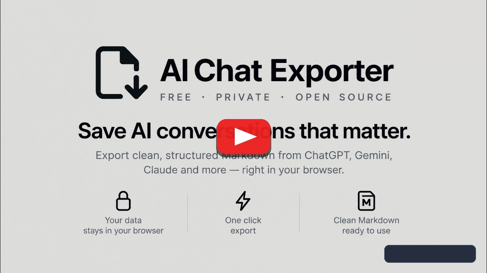

<div align="center">

# AI Chat Exporter

## Save, back up, and transfer your AI chats in 1 click.

**ChatGPT, Claude, Gemini, DeepSeek & 18+ models → Markdown, PDF, Word, PNG, or Obsidian.**  
_100% Free. 100% Local in your browser. Zero accounts, zero cloud servers._

  <br />

  <!-- Big Clickable Store Badges -->
  <a href="https://chromewebstore.google.com/detail/ai-chat-exporter-free-pri/cgakhbhkplndjjknhgegfcipffflcaoj">
    
  </a>
  <a href="https://addons.mozilla.org/en-US/firefox/addon/ai-chat-export/">
    
  </a>
  <a href="https://microsoftedge.microsoft.com/addons/detail/ace-%C2%B7-export-chatgpt-clau/hbgckjgfhnaedlihmkogenclfcnobicg">
    
  </a>

<br />

  <!-- Live Project Trust & Status -->


<a href="LICENSE"></a>

<br />

[Supported Platforms](#supported-platforms) • [Features](#features) • [Chat Continuation](#chat-continuation) • [Permissions](#permissions) • [Sponsor](#sponsor)

</div>

<br />

> [!TIP]
> **⭐ If you find ACE helpful, click "Star" in the top-right corner!** AI platforms change their layouts frequently. Starring bookmarks the repository so you can easily find updates of this local-first open source app without paywalls.

---

<div align="center">

### 🎬 See ACE in Action

<a href="https://www.youtube.com/watch?v=5V2EZqDkUnU" target="_blank">
  
</a>

<br />

<sub>▶️ **1-minute walkthrough:** Chat continuation, selective export, live themes, and PNG downloads · <a href="https://ace.covai.org/">ace.covai.org</a></sub>

</div>

---

<a id="features"></a>

## ✨ Why People Switch to ACE

<div align="center">

<a href="https://chromewebstore.google.com/detail/ai-chat-exporter-free-pri/cgakhbhkplndjjknhgegfcipffflcaoj"></a>
<a href="https://addons.mozilla.org/en-US/firefox/addon/ai-chat-export/"></a>

</div>

### 🔄 Switch AI Mid-Conversation

Hit a message limit on Claude? Start in ChatGPT and click **Continue in Claude / Gemini / DeepSeek**. ACE moves your entire conversation over automatically—no manual copy-pasting required.

### 📝 Clean Notes & Intact Math

Exports clean Markdown, PDF, or Word docs with intact code blocks, tables, and **LaTeX math equations** (`$$...$$` and `$...$`). Send in 1 click straight to **Obsidian, Logseq, or Bear**, or paste cleanly into **Notion**.

### 📸 Pretty Screenshots & Selective Export

Preview chats in **Dark, Light, or Solarized** themes. Uncheck messages you don't need, and export a crisp **PNG image** or print-ready **PDF** with complete syntax highlighting.

### 🔒 100% Offline in Your Browser

Many exporters secretly send your chats to their cloud servers. ACE runs **entirely inside your browser**. Zero servers, zero telemetry, zero accounts, and zero subscriptions.

<div align="center">

<a href="https://chromewebstore.google.com/detail/ai-chat-exporter-free-pri/cgakhbhkplndjjknhgegfcipffflcaoj"></a>
<a href="https://addons.mozilla.org/en-US/firefox/addon/ai-chat-export/"></a>
</div>

---

<a id="supported-platforms"></a>

## 🌐 Supported Platforms & Destinations

### 📄 Formats & Note Destinations

| Type                | Destinations & Apps                                                                                                                                       | How It Works                                                                                                            |
| :------------------ | :-------------------------------------------------------------------------------------------------------------------------------------------------------- | :---------------------------------------------------------------------------------------------------------------------- |
| **Files**           | Markdown (`.md`), PDF, Word (`.doc`), HTML, PNG image, JSON ([Schema v1](schemas/export-v1.schema.json)), Plain Text                                      | Instant client-side download with intact LaTeX math (`$$...$$`), syntax highlighting & attachments                      |
| **PKM Apps**        | [Obsidian](https://obsidian.md), [Logseq](https://logseq.com), [Bear](https://bear.app), [NotePlan](https://noteplan.co), [Drafts](https://getdrafts.com) | 1-click URI scheme creates a note directly in your vault with pre-populated frontmatter                                 |
| **Smart Clipboard** | [Notion](https://notion.so), Google Docs, Apple Notes, Word, Email                                                                                        | Dual-MIME copy places clean Markdown (`text/plain`) and rich styled HTML (`text/html`) on your clipboard simultaneously |

### 🤖 Supported AI Platforms & Continuation

| Capability                            | Supported Platforms                                                                                                                                                                                                                                                                                                                                                                                                                              | Features                                                                                              |
| :------------------------------------ | :----------------------------------------------------------------------------------------------------------------------------------------------------------------------------------------------------------------------------------------------------------------------------------------------------------------------------------------------------------------------------------------------------------------------------------------------- | :---------------------------------------------------------------------------------------------------- |
| **🔄 Extract + 1-Click Continuation** | [ChatGPT](https://chatgpt.com) · [Claude](https://claude.ai) · [Google Gemini](https://gemini.google.com) · [DeepSeek](https://chat.deepseek.com) · [Perplexity](https://www.perplexity.ai) · [Grok](https://grok.com) · [Mistral Le Chat](https://chat.mistral.ai) · [Qwen](https://chat.qwenlm.ai) · [Proton Lumo](https://lumo.proton.me)                                                                                                     | **Bidirectional:** Export full conversation and seamlessly transfer context into another model        |
| **📥 High-Fidelity Extraction Only**  | [NotebookLM](https://notebooklm.google.com) · [Microsoft Copilot](https://copilot.microsoft.com) · [Google AI Studio](https://aistudio.google.com) · [Google Search AI Overviews](https://www.google.com) · [Meta AI](https://www.meta.ai) · [Google Cloud Assist](https://console.cloud.google.com) · [Duck.ai](https://duck.ai) · [Z.ai](https://z.ai) · [Joyland](https://www.joyland.ai) · [Chub AI](https://chub.ai) · Generic Web Articles | Extracts complete conversation threads, reasoning traces (`<think>`), search sources, and audio notes |

---

## 🚀 How It Works (3 Clicks)

_Trusted by thousands of active users across Chrome, Firefox, and Edge._

1. **Open any AI chat** (ChatGPT, Claude, Gemini, DeepSeek, etc.).
2. **Click the ACE icon** in your toolbar (or open the browser Side Panel).
3. **Export or Transfer:** Download as a file, send straight to Obsidian, or click **Continue in...** to jump to another AI model.

---

<a id="chat-continuation"></a>

## 🔄 Cross-Model Chat Continuation

Chat Continuation is the feature that sets AI Chat Exporter apart from every other exporter — it lets you hand off a live conversation from one AI to another in a single click, with full context preserved.

```
ChatGPT  ──►  [ Export + Inject ]  ──►  Claude
Claude   ──►  [ Export + Inject ]  ──►  Gemini
Gemini   ──►  [ Export + Inject ]  ──►  DeepSeek  (or any supported target)
```

**How it works:**

1. **Extract** — Click the extension on any supported platform. The full conversation thread is parsed locally.
2. **Format** — The thread is wrapped into a structured handoff prompt that preserves roles (user / assistant), turn order, and any code or math blocks.
3. **Inject** — The formatted context is placed directly into the input field of your chosen target platform. You resume the conversation immediately — no copy-pasting, no reformatting.

**Also works with PKM apps:** Send the conversation directly into **Obsidian** (via `obsidian://new`), **Logseq**, **Bear**, **NotePlan**, or **Drafts** with frontmatter metadata (`title`, `date`, `model`, `source`) pre-populated.

---

<a id="permissions"></a>

## 🛠️ Technical Details, Permissions & Privacy Audit

_Click any section below to expand permissions, manual installation, or developer architecture:_

<details>
<summary><b>🔐 Why Does ACE Need Browser Permissions? (100% Offline Guarantee)</b></summary>
<br>

Most AI exporters and extensions send your chat history or API calls to third-party backend servers. **AI Chat Exporter is 100% local:**

- **Zero Remote Processing:** All DOM extraction, markdown generation, LaTeX parsing, and image rendering occur entirely inside your local browser.
- **Zero Telemetry / Zero Tracking:** No analytics, no trackers, no external logging, and no remote dependencies.
- **Your Data Remains Yours:** Chat threads, custom instructions, and exported files stay on your machine unless you explicitly transfer them to another service, such as an AI platform through **Continue in...**.

**Verifiable by design.** The extension runs client-side with zero remote code execution:

| Permission                        | Why it's needed                                                                           |
| :-------------------------------- | :---------------------------------------------------------------------------------------- |
| `activeTab` / `tabs`              | Read the active conversation and coordinate continuation tabs                             |
| `storage`                         | Persist local preferences (theme, format defaults, vault names) offline                   |
| `sidePanel`                       | Power the Chromium side panel UI and message selection picker                             |
| `clipboardWrite`                  | Used only when you click "Copy" to place clean Markdown and rich HTML onto your clipboard |
| `downloads`                       | Save generated `.md`, `.json`, `.doc`, `.html`, or `.png` files locally to your machine   |
| `host_permissions` (`<all_urls>`) | Extract web articles and detect embedded chat frames (e.g., Copilot in Microsoft 365)     |

Zero external analytics endpoints. Zero remote dependencies. Zero outbound network fetches. Audit it yourself: [`wxt.config.ts`](wxt.config.ts).

</details>

<details>
<summary><b>📦 Manual / Unpacked Installation (.ZIP)</b></summary>
<br>

### Chrome / Edge / Brave / Chromium

1. Download the latest `ai-chat-exporter-chromium.zip` from the [Releases page](https://github.com/Covai-Labs/ace/releases/latest).
2. Extract the zip file to a folder on your computer.
3. Open your browser and navigate to `chrome://extensions/` (or `edge://extensions/`).
4. Enable **Developer mode** using the toggle switch in the top-right corner.
5. Click **Load unpacked** and select the extracted folder.

### Firefox

1. Download the latest `ai-chat-exporter-firefox.zip` from the [Releases page](https://github.com/Covai-Labs/ace/releases/latest).
2. Extract the zip file to a folder on your computer.
3. Open Firefox and navigate to `about:debugging#/runtime/this-firefox`.
4. Click **Load Temporary Add-on...**
5. Select `manifest.json` inside the extracted folder.

</details>

<details>
<summary><b>🏗️ Architecture, Stack & JSON Schema v1</b></summary>
<br>

ACE is powered by auditable, local-only open-source libraries:

- **[WXT Framework](https://wxt.dev/) (`entrypoints/`):** Modern cross-browser extension framework compiling cleanly to Manifest V3 (Chromium) and Firefox targets inside `.output/`.
- **[decant-core](https://github.com/Covai-Labs/decant):** Our shared modular parsing engine for 18+ AI platforms and web articles.
- **Sanitization & Markdown:** [DOMPurify](https://github.com/cure53/DOMPurify) for security sanitization and [Turndown.js](https://github.com/mixmark-io/turndown) for HTML to Markdown conversion.
- **Math & Syntax Highlighting:** [KaTeX](https://github.com/KaTeX/KaTeX) for LaTeX rendering (`$$...$$` and `$...$`) and [Prism.js](https://github.com/PrismJS/prism) for code blocks.
- **Standardized JSON Schema:** Emits normalized chat objects adhering to [Export Schema v1](schemas/export-v1.schema.json) preserving role trees, timestamps, model metadata, and reasoning traces (`<think>`) for programmatic workflows.

```bash
# Build from source
git clone https://github.com/Covai-Labs/ace.git
cd ace
npm install

# Dev mode (hot reloading)
npm run dev                 # Chromium
npm run dev -- -b firefox   # Firefox

# Production builds
npm run build               # Chromium (.output/chrome-mv3)
npm run build:firefox       # Firefox (.output/firefox-mv3)
```

</details>

---

## 🤝 Contributing

Contributions are welcome! If an AI chat interface updates its DOM or you want to add support for a new platform, see the [Development Guide](DEVELOPMENT.md) for build steps, parser guidelines, and the test harness.

1. Check existing [Issues](https://github.com/Covai-Labs/ace/issues) or open a new one with the platform name and DOM context.
2. Submit a Pull Request following the [Contribution Guidelines](.github/CONTRIBUTING.md).

</br>

### 🌐 Translations & Localization

Help translate AI Chat Exporter into your language! All translations are managed through [Weblate](https://hosted.weblate.org/projects/ace/):

[](https://hosted.weblate.org/engage/ace/)

You can contribute translations directly in your browser without writing code or submitting PRs manually. See [Translating & Localization](.github/CONTRIBUTING.md#translating--localization).

</br>

---

<a id="sponsor"></a>

## ☕ Back Independent Development

AI Chat Exporter is developed and maintained by an independent solo developer. Unlike cloud scrapers, the extension and its chat processing run 100% locally in your browser with zero tracking, telemetry, or remote servers.

Because AI platforms constantly push layout updates that break DOM extraction, keeping parsers working requires continuous maintenance and rapid patching. If ACE saves you time in your daily workflow, consider [sponsoring on GitHub](https://github.com/sponsors/deadrat-in) to help keep this project alive and actively maintained.

<div align="center">

  <a href="https://github.com/sponsors/deadrat-in">
    
  </a>
  <a href="https://github.com/Covai-Labs/ace">
    
  </a>

<br />

</div>

---

## 📜 License

This software is licensed under the **GNU Affero General Public License v3.0 (AGPL-3.0-only)** with an additional **FOSS Linking Exception**. See [LICENSE](LICENSE) for the full AGPL-3.0 license text and [FOSS-EXCEPTION.md](FOSS-EXCEPTION.md) for exception permissions and commercial licensing details.

### Third-Party Test Fixtures Notice

Sample test fixtures located in [`tests/fixtures/`](tests/fixtures/) consist of third-party DOM snapshots and API response excerpts retained solely for automated regression testing and platform interoperability under fair use principles. They are excluded from the project's AGPL-3.0 license. See [`tests/fixtures/README.md`](tests/fixtures/README.md) for details.

---

## 🙏 Acknowledgments

- [decant-core](https://github.com/Covai-Labs/decant) — Shared parser engine and intelligent article extraction.
- [Turndown.js](https://github.com/mixmark-io/turndown) — HTML to Markdown conversion.
- [DOMPurify](https://github.com/cure53/DOMPurify) — HTML sanitization.
- [html2canvas](https://github.com/niklasvh/html2canvas) — Client-side PNG rendering.
- [KaTeX](https://github.com/KaTeX/KaTeX) — Math and LaTeX equation rendering.
- [Prism.js](https://github.com/PrismJS/prism) — Code block syntax highlighting.
- [WXT](https://wxt.dev/) — Extension development framework.
